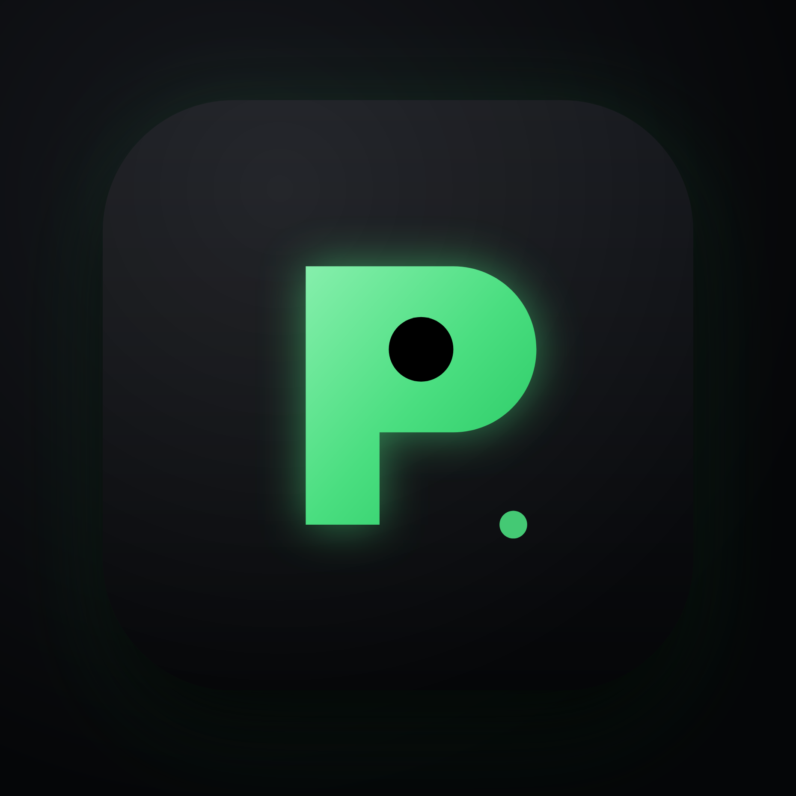
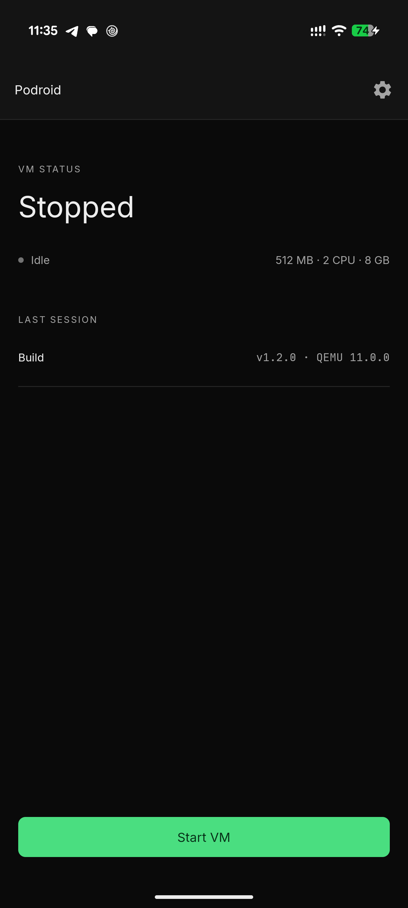
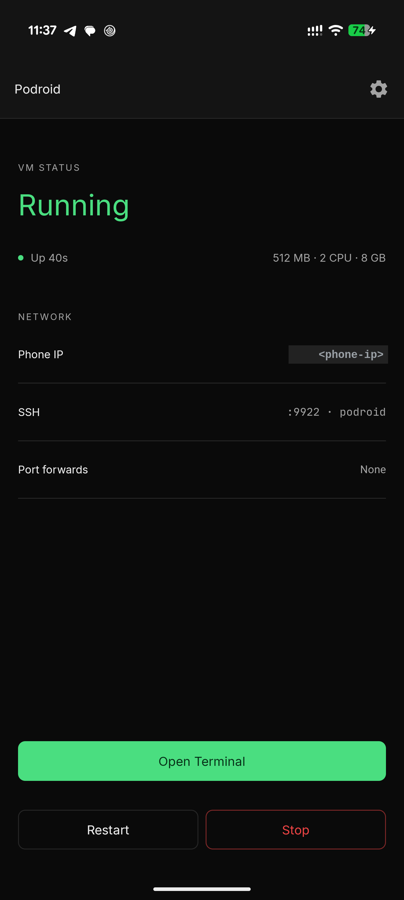
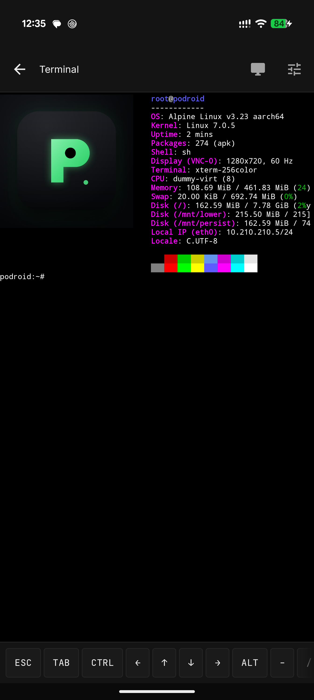
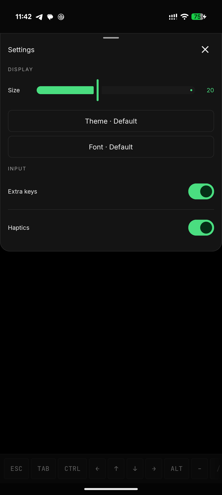

<div align="center">



# Podroid

**Run Linux containers and a full Linux desktop on your Android phone. No root.**

A real Debian 12 (Bookworm) Linux VM with its own kernel - not a chroot or proot trick - so **Podman, Docker and LXC** behave exactly like they do on a server.

[](https://github.com/voorz/podroid-air/releases)
[](https://github.com/voorz/podroid-air/releases)
[](https://github.com/voorz/podroid-air/stargazers)
[](LICENSE)


[**Website**](https://extv.github.io/Podroid/) · [**Documentation**](https://extv.github.io/Podroid/guide/) · [**Download APK**](https://github.com/voorz/podroid-air/releases/latest)

<table>
  <tr>
    <td align="center" width="25%"><br /><sub><b>Home</b></sub></td>
    <td align="center" width="25%"><br /><sub><b>Running</b></sub></td>
    <td align="center" width="25%"><br /><sub><b>Terminal</b></sub></td>
    <td align="center" width="25%"><br /><sub><b>Themes &amp; fonts</b></sub></td>
  </tr>
</table>

</div>

## What you get

- **Podman, Docker and LXC** - pre-installed, ready the moment it boots
- **A real VM** - Debian 12 (Bookworm) on a custom kernel via QEMU, or hardware-accelerated AVF on supported pKVM devices
- **In-app terminal** - full xterm-256color, 122 color themes, 13 fonts, live resize
- **X11 desktop** - run GUI Linux apps in a built-in viewer with touch, keyboard, mouse and audio
- **USB passthrough**, **SSH**, **port forwarding** and a **guest-to-Android bridge**
- **Container backup**, a **live VM/device status view** and **Downloads-folder sharing** with the guest
- **English and 中文**, no root, any arm64 device on Android 8+

## Quick start

1. [Download the APK](https://github.com/voorz/podroid-air/releases/latest) and install it.
2. Tap **Start VM**, wait for **Ready!**, open the terminal.

```sh
# rootless containers, straight away
podman run --rm alpine echo "hello from a container"
docker run -d -p 8080:80 nginx

# expose that container to your phone and LAN, right from the VM shell
podroid-forward add 8080 8080 tcp     # TCP or UDP, on both the QEMU and AVF backends
curl http://<phone-ip>:8080
podroid-forward clean                 # remove every rule you added, in one go

# SSH in from your laptop (enable SSH in the setup wizard or Settings)
ssh root@<phone-ip> -p 9922        # password: root

# read this documentation with no network connection
podroid-forward add 9980 9980 tcp     # forward the docs port to the phone
podroid-docs                          # serves docs/guide at http://127.0.0.1:9980
```

Setup, the two backends, networking, the X11 viewer and troubleshooting all live in the **[documentation](https://extv.github.io/Podroid/guide/)**.

## Build

```sh
git clone https://github.com/voorz/podroid-air.git
cd podroid-air
./build-all.sh all     # kernel, rootfs, QEMU and APK (needs Docker + Android SDK/NDK)
```

Per-component builds and toolchain details: [CONTRIBUTING.md](CONTRIBUTING.md).

## Contributing

Contributions of every size are welcome: bug reports, kernel-config tweaks, new themes, UI polish, X11 input fixes, anything.

- **Pull requests:** read [CONTRIBUTING.md](CONTRIBUTING.md) first. Keep changes scoped, run `./build-all.sh test` before pushing, and explain *why* in the PR description.
- **Bug reports:** [open an issue](https://github.com/voorz/podroid-air/issues/new) with your device and Android version, a short repro, and the diagnostic log (**Settings → Export Diagnostic Log** in the app).

## Related projects

**[RikkaHub Agent](https://github.com/ExTV/rikkahub-agent)** is a fork of [RikkaHub](https://github.com/rikkahub/rikkahub), the native Android LLM chat client, that turns it into a real on-device agent: 80+ device tools, scheduled jobs, an AI-driven browser, a Linux workspace, SSH, screen automation and a remote Telegram bot, all opt-in. Its SSH tool can log into a running Podroid VM (`localhost:9922`), so an agent on your phone can build, run and inspect containers without you typing a command.

## Credits

| | |
|---|---|
| [QEMU](https://www.qemu.org)                   | Machine emulation |
| [Termux](https://github.com/termux/termux-app) | Terminal emulator engine |
| [Debian](https://www.debian.org)             | The guest distribution |
| [ExTV/Podroid](https://github.com/ExTV/Podroid) | Original project |

Full list in [CREDITS.md](CREDITS.md).

## License

[GPLv2](LICENSE). If Podroid is useful to you, a [star](https://github.com/voorz/podroid-air/stargazers) helps other people find it.
